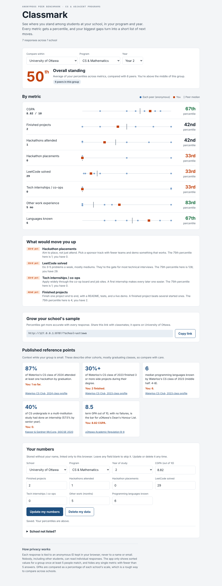

# Classmark

A peer benchmark for computer science and adjacent students. Verify with your school email, enter your numbers (GPA, projects, hackathons, LeetCode, internships…), and see your **percentile on each metric** among students at your school, in your program and year, plus an overall standing and a ranked list of what would move you up. Visitors who aren't signed in see only the average student.



## Features

- **School-email sign-in**: a one-time code (or link) sent to a school address. No passwords. Your school is decided by your email domain (`@uottawa.ca` → University of Ottawa), so nobody can pose as another school's student.
- **Average student for visitors**: signed out, you see one average per metric for any school, program and year. Distributions and percentiles need a verified school email.
- **Per-metric percentiles** (mid-rank method) and an **overall standing**, which is the mean of your metric percentiles
- **Dot-plot distributions**, showing every anonymous peer, the median, and you
- **Next moves**: your weakest metrics, each with the 75th-percentile value to aim for
- **Career tracks**: weigh the overall standing and next moves for software engineering, ML / research or quant instead of counting every metric the same. The weights are a rough guide (`TRACKS` in `src/stats.ts`), and the choice is remembered in the browser.
- **What-if slider**: move one of your numbers ("if I solve 50 more LeetCode problems…") and see the new percentile and overall standing against the same peers. It runs in the browser only; nothing is saved.
- **Multi-school**: each school has its own GPA scale (4.0, 4.3, 10-point, 12-point, percentage) and email domain. Students can request new schools, which go live once an admin approves them.
- **Filters**: your school or all schools, any program, any year
- **Share links**: `/?school=uottawa` opens on a school, for growing the sample
- **Your data, your call**: delete your numbers, or your whole account, any time

## Privacy and security model

Privacy is enforced in the database, not the UI:

- Tables have row-level security on and **no direct grants**. The browser can only call a few `SECURITY DEFINER` functions; internal helpers can't be called at all.
- **Signed out**: `average_student()` returns one mean per metric, never lists of values.
- **Verified students**: `peer_stats()` returns **sorted value arrays only**, never rows or IDs.
- **Minimum group size**: a group, or any single metric, with fewer than **5** people is hidden.
- **Differencing protection**: a group is also hidden when a wider group (drop the school, program or year filter) has only 1 to 4 more people. Without this, subtracting "uOttawa, all programs" from "uOttawa, CS" could reveal one student's numbers. The same rule applies to each metric.
- **Email stays with auth**: the `responses` table has no name or email. `get_my_response()` only ever returns the caller's own row.
- **Sign-up guard**: a trigger on `auth.users` refuses addresses outside approved school domains, so the sign-in form can't be used to email random inboxes. `save_my_response()` checks the domain again.
- **Security headers** (`vercel.json`, `public/_headers`): a strict Content Security Policy, no framing, HSTS, nosniff.
- **Optional CAPTCHA**: Cloudflare Turnstile on the sign-in form.

Classmark is an independent student project, not affiliated with or endorsed by the University of Ottawa or any other school.

One honest caveat: you, as the project admin, can join `responses` to `auth.users` in the Supabase dashboard. The privacy promise is that other students can't see individual answers, not that the admin can't.

## Stack

| Layer | Choice |
|---|---|
| Frontend | React 19 + TypeScript + Vite, no UI framework; hand-built SVG charts |
| Backend | Supabase: Postgres, email OTP auth, PostgREST RPC |
| API client | small fetch wrapper (`src/api.ts`), no SDK |
| Tests | Node test runner (math + auth client), SQL tests on real Postgres (security + privacy rules), Playwright end-to-end |

## Run it yourself

### 1. Create the database (free)

1. Create a project at [supabase.com](https://supabase.com).
2. Open the **SQL Editor** and run, in order: `supabase/migrations/0001_init.sql`, `supabase/migrations/0002_school_email.sql`, then `supabase/seed.sql`. The seed adds 10 Canadian schools with their email domains.
   - Already ran `0001` and the old seed? Just run `0002` and then `seed.sql`. `0002` deletes any responses left over from the anonymous version, since they can't be verified.
3. **Authentication → Sign In / Providers**: keep **Email** on, turn **Allow anonymous sign-ins** off.
4. **Authentication → Emails → Templates**: in both **Confirm signup** and **Magic Link**, add the code so students can type it:
   ```html
   <h2>Your Classmark code</h2>
   <p>Enter this code on Classmark: <strong>{{ .Token }}</strong></p>
   <p>Or <a href="{{ .ConfirmationURL }}">sign in with this link</a>.</p>
   ```
   (New students get "Confirm signup", returning ones get "Magic Link".)
5. **Set up custom SMTP before launch** (Authentication → Emails → SMTP Settings). Supabase's built-in email only sends to your own team members, about 2 an hour, so real students won't get codes without it. Resend, Postmark, Brevo or Amazon SES all work.
6. **Authentication → URL Configuration**: set the Site URL to your deployed address (for example `https://classmark.vercel.app`), so the link in the email comes back to the app.
7. Under **Project Settings → API**, copy the project URL and the `anon` public key.

### 2. Run locally

```bash
cp .env.example .env      # paste the URL and anon key into .env
npm install
npm run dev               # http://localhost:5173
```

### 3. Deploy (free)

Push the repo to GitHub, then import it on [Vercel](https://vercel.com) (`vercel.json` sets the build and security headers) or [Netlify](https://netlify.com) (`public/_headers`):

- Framework: **Vite**. Build command `npm run build`, output folder `dist`.
- Environment variables: `VITE_SUPABASE_URL`, `VITE_SUPABASE_ANON_KEY`, and optionally `VITE_TURNSTILE_SITE_KEY`.

The anon key is designed to be public. Security comes from the database functions and grants.

### 4. Optional: CAPTCHA

Create a Turnstile widget in Cloudflare, put its **site key** in `VITE_TURNSTILE_SITE_KEY`, and put its **secret key** in Supabase under **Authentication → Attack Protection → CAPTCHA**. Turn both on together: with only one side set, sign-in fails.

## Admin

Run these in the Supabase SQL Editor.

```sql
-- see pending school requests (check the domain really belongs to the school before approving)
select slug, name, country, gpa_scale, email_domains, created_at from schools where not approved;

-- approve one
update schools set approved = true where slug = 'yorku';

-- add another email domain to a school
update schools set email_domains = array_append(email_domains, 'other-domain.ca') where slug = 'your-school';

-- participation by school
select slug, name, responses from list_schools();
```

## Tests

```bash
npm test                                                  # percentile math + auth client (Node test runner)
PG_ARGS="-h localhost -U postgres" npm run test:db        # 55 database checks: sign-up guard, privacy rules, ownership, validation
PG_ARGS="-h localhost -U postgres" npm run test:e2e       # full browser flow, signed out and verified
```

The database and end-to-end tests run on plain PostgreSQL. `test/supabase_stub.sql` recreates the bits of Supabase the schema uses (`auth.users`, `auth.uid()`, the `anon` and `authenticated` roles). `test/e2e/mock_supabase.py` serves the same API shape as Supabase (email codes, sessions, RPC) on top of the real SQL functions and sends the real security headers, so the browser test exercises the actual grants, privacy rules and CSP. The end-to-end run needs Python with `playwright` installed.

## Project layout

```
src/
  api.ts             email sign-in + RPC client
  stats.ts           percentile, quantile, scoring, career-track weights, gaps
  references.ts      published benchmark figures (with sources)
  App.tsx            page: sign-in, filters, average student or standing, metrics, moves, form
  components/        SignIn, StripChart, ProfileForm, RequestSchool, WhatIf
supabase/
  migrations/0001_init.sql            schema, privacy functions, grants
  migrations/0002_school_email.sql    school-email sign-in, average student, differencing protection
  seed.sql                            starter schools and their email domains
public/_headers      security headers (Netlify)
vercel.json          build + security headers (Vercel)
test/                unit, database and end-to-end tests
```

## Known limits and next steps

- **Self-reported data.** Verified students can still enter anything. Verification stops outsiders and fake schools, not exaggeration.
- **Staff and alumni addresses** on a school domain can also sign in.
- **Changes over time.** Someone watching a small group before and after one person joins could estimate that person's numbers. Showing results only after a group grows by several people, or refreshing on a schedule, would close this.
- **Cross-school GPA** is compared as a percentage of each school's scale, which is a rough approximation. Comparisons within one school are exact.
- **Ideas:** track your own progress over time.
